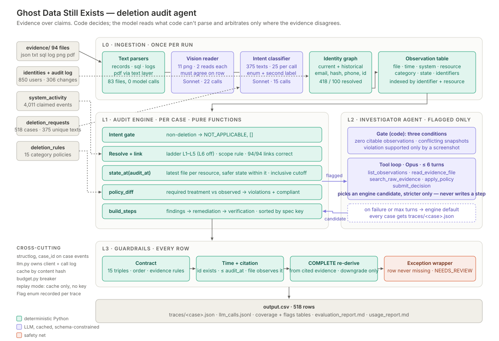

# Ghost Data Still Exists — deletion-audit agent

For every request in `dataset/deletion_requests.csv` this system decides
whether the person asked for deletion, reconstructs every copy of their data
that the evidence shows at the case's `audit_at`, applies
`deletion_rules.csv`, and writes `output.csv` (`case_id,deletion_status,steps_json`).

The organizer's original README is kept in the repository as `HACKERRANK_README.md` (it is not part of `code.zip`).

## Approach in brief

Every step in `output.csv` is generated by code from a table of observations
extracted from the evidence. Models are used only where code cannot read the
input: screenshots (vision) and request texts in many languages (intent), plus
an investigator agent on the few cases the engine flags. Model outputs are
constrained and cross-checked. Screenshots are read twice: a row is admitted
when two readings agree (or a tiebreak reading sides with one); for an id the
text evidence already knows, disagreement keeps the reading worse for the
subject and flags `VISION_DISAGREED`. Intent is an enum per request that
decides only whether the case is audited; the request text never reaches the
engine, and a non-deletion label on a request flagged as carrying processing
instructions is audited as a deletion anyway, on purpose: a spurious audit
costs one row, an erased audit is the attack succeeding. The agent only chooses between
decisions the engine generated, and only stricter ones.

Reported statuses and activity `reported_result` values are treated as claims:
state comes only from evidence, and only from evidence captured at or before
`audit_at`.

## Architecture (five layers)



Text version: `dataset/` → **L0** text parsers (`ingest/parse_records.py`,
`parse_sql.py`, `parse_logs.py`, PDFs by text layer), vision reader
(`parse_vision.py`: 2 Sonnet readings per PNG, tiebreak on Opus), intent
classifier (`intent.py`), identity graph (`identity.py`) → observation table
(`ingest/observations.py`) → **L1** per case (`engine/decide.py`: intent gate →
`linking.py` → `engine/state.py` `state_at` → `engine/policy.py`
`policy_diff` → `engine/steps.py` `build_steps`) → **L2** agent on flagged
cases (`agent/`, ≤ 6 turns, stricter candidates only) → **L3** guards on every
row (`guards.py` via `main.py`: contract, policy contract, time + citation,
COMPLETE re-derivation, regenerate then repair, cross-row check, exception
wrapper) → `output.csv`, `runs/<mode>/<id>/traces/`, `llm_calls.jsonl`, run
manifest. The full design brief, with the agent anatomy diagram, is
`code/DESIGN.md`; `code/CODE_MAP.md` lists each module's job and key functions.

| Layer | What it does | Code |
|---|---|---|
| L0 Ingestion | One parser per format (JSON/TXT records, SQL snapshots run in SQLite, logs in seven line syntaxes joined by trace id, PDF text, PNG via vision) producing `Observation(file_id, captured_at, observed_at, system_id, resource_id, data_category, state, identifiers, source_detail, vision)` plus `Coverage` records for complete snapshots. Identity index over current and historical identifiers. Request intent. | `code/ghostaudit/ingest/`, `identity.py`, `intent.py` |
| L1 Audit engine | Per case, pure functions: resolve the subject → link resources (ladder below) → scope → `state_at(audit_at)` → `policy_diff` → `build_steps` (sorted by the spec's operation table, numbered). Status follows from the steps. | `code/ghostaudit/linking.py`, `engine/` |
| L2 Investigator agent | Runs only on cases the gate flags (a resolved subject with zero citable observations; one resource in conflicting states in the same capture; a violation supported only by a held screenshot row). Six turns on `claude-opus-5-5` over five strict tools. It chooses between decisions the engine generated; it can make the audit **stricter, never looser** — every candidate keeps the engine's findings and resources and never turns INCOMPLETE into COMPLETE. Its one way to add a candidate is `apply_policy` on a record the parsers did not extract from that file: the id must appear in an eligible text, log, SQL or PDF file with one of the subject's identifiers within 15 lines of it. The agent supplies that record's state; the monotone rule only lets it make the decision stricter. | `code/ghostaudit/agent/` |
| L3 Guardrails | Applied to every row as it is written. Contract checks (allowed triples, numbering, order, evidence rules per status, finding ⇒ remediation ⇒ verification, citations exist and are ≤ `audit_at`); a citation guard (each cited file explicitly observes the resource it is cited for, or, for an ABSENT claim, omits it from a complete snapshot); a COMPLETE row is re-derived from its cited files alone and downgraded to INCOMPLETE (`COMPLETE_DOWNGRADED`) when they show a violation; a policy contract (no `DELETE_RECORD` on audit, legal-hold, backup, tombstone, support-message or analytics records unless their retention date has passed; no `cache_*` / `email_delivery_*` resource in output). A failing row is regenerated by the engine, then repaired from its cited evidence (`CONTRACT_REPAIRED`). Cross-row: one row per request (518 for the evaluation file) and a warning in the manifest if the status mix drifts from the sample mix. Every case gets a row: a case that raises gets a COMPLETE `[]` row with `ENGINE_ERROR` and `NEEDS_REVIEW` (not re-guarded); if intent classification fails the run continues with every request audited as a deletion; if the world fails to load every case is written as that row and the run exits 1; a damaged cache entry is a cache miss. | `code/ghostaudit/guards.py`, `code/main.py` |
| L4 Observability | structlog warnings at every fallback, one JSON trace per case, a run manifest per run, `runs/llm_calls.jsonl` with model, tokens and cost per call, a call/spend breaker. | `telemetry.py`, `llm.py`, `budget.py` |

### Linking resources to the subject

Deleted and anonymized records carry no identifier, so links are built in
layers; each link records its layer and confidence and appears in the trace.
Every set of identifiers, links or candidates is sorted before it feeds
output or a tie-break, so neither manifest order nor parser order can change
a row (the `metamorphic` suite checks this).

| Layer | Evidence | Samples precision |
|---|---|---|
| L1 | identifier (email, phone, hash, user_id) in evidence captured ≤ `audit_at` | 75/76 |
| L2 | `LINK_RESOURCE_IDENTITY` rows in `system_activity.csv` | 0/2 (both removed by the scope rule) |
| L3 | identifier in a snapshot taken ≤ `audit_at` inside a file exported later — link only, never cited | 7/7 |
| L4 | PDF text and screenshots | 1/1 |
| L5 | the only free primary-profile delete within 90 min of `reported_at` whose worker result matches `reported_status`, solved jointly across all requests | 11/11 |
| L6 | analytics anonymization in the same worker run — **off in every run** (1/3; reproduce with `--suite samples --observations-only --enable-sibling`) | — |

L5 rests on one idea: reported_status tells us which worker run belonged to
this request, and the evidence tells us what state that run left behind.

A scope rule drops resources that belong to an earlier request of the same
user (already ABSENT before `requested_at`, or linked before it with no
evidence since).

## Setup

Python 3.12. The challenge data is not shipped: put the challenge's `dataset/`
folder at the repository root, next to this README (the code reads
`dataset/deletion_requests.csv`, `dataset/evidence/`, …).

`pyproject.toml`, `uv.lock` and the virtual environment live at the
repository root; run every command from there. With uv (recommended):

```bash
uv sync                      # creates .venv at the repo root from uv.lock
source .venv/bin/activate    # or prefix each command below with `uv run`
python code/main.py          # writes output.csv at the repo root
```

With pip (any Python 3.12 interpreter; if `python3.12` is not on your PATH,
`uv python install 3.12` provides one and `uv python find 3.12` prints its path):

```bash
python3.12 -m venv .venv
.venv/bin/pip install -r requirements.txt
source .venv/bin/activate
```

Credentials: copy `.env.example` to `.env` and set `ANTHROPIC_API_KEY`.
`MODEL_VISION`, `MODEL_INTENT` and `MODEL_AGENT` are optional overrides.
`.env` is gitignored and never logged. Model access has three modes, chosen
automatically and recorded in each run manifest:

- **live** (a key is set): cached answers are replayed, anything new is called.
- **replay** (no key, but a model-answer cache in `code/.cache/llm/`): only
  cached answers are used; a miss is never called, it degrades with a flag.
- **none** (no key and no cache, or `GHOSTAUDIT_OFFLINE=1`): PDFs and every
  text format are still parsed; screenshots are deferred
  (`VISION_UNAVAILABLE`), every request is audited as a deletion
  (`INTENT_UNAVAILABLE`), and gated cases keep the engine decision
  (`AGENT_UNAVAILABLE`). The run still writes all 518 rows.

## Run

```bash
# from the repo root, with .venv active
# final output: all 518 evaluation requests -> output.csv at the repo root
python code/main.py --mode measure

# iteration: same cases -> code/runs/tune/output.csv
python code/main.py --mode tune

# the 32 labelled samples
python code/main.py --mode tune --requests dataset/sample_deletion_requests.csv \
    --out code/runs/tune/sample_output.csv
```

`--mode measure` replays cached model answers only: it refuses live model
calls unless `--allow-live` is passed (a cache miss degrades with its flag
instead), and writes `output.csv` only if the cross-row check passes. Each run
writes `code/runs/<mode>/<run_id>/traces/<case_id>.json` and
`run_manifest.json` (commit hash, dirty-tree flag, whether live calls were
allowed, effective model access, status counts, flags, models, model usage).

## Evaluation harness

```bash
python code/evaluation/main.py --suite <suite> [--mode tune|measure]
uv run pytest            # 132 offline tests (need dataset/ in place); they never call a model.
                         # One checks the policy contract on a tune run's output and is
                         # skipped until `code/main.py --mode tune` has run once.
uv run ruff check code   # lint (config in pyproject.toml)
```

| Suite | Protects against | State |
|---|---|---|
| `contract` | any malformed row: header, row count and order, JSON, fields, allowed triples, step order, evidence rules by status, citations unknown or after `audit_at`; the policy contract (categories from the run's traces when found) | implemented |
| `samples` | wrong decisions: status accuracy and confusion, step precision/recall, field accuracy on aligned steps, exact sequence; per-case dump with the observations behind each step (traces from the run that wrote `--pred`). `--observations-only` reports the linking ladder layer by layer (`--enable-sibling` measures L6) | implemented |
| `coverage` | silent parser failures: files parsed/failed/deferred per format, rows, whether each sample's cited file yields an observation for its user, zero-observation cases, cases resting on exactly one eligible evidence file, resources claimed by two users | implemented |
| `custom` | intent errors and prompt injection: a 20-row hand-labelled multilingual gold set; rows with auditor-directed instructions must produce byte-identical steps to the stripped requests (on an ungated carrier this holds whenever the two labels match); and the privacy-intake cross-check: the cases `system_activity.csv` records as classified non-deletion must equal the classifier's NOT_APPLICABLE set | implemented (needs credentials or a warm cache) |
| `metamorphic` | order/case sensitivity and time leaks, engine only (agent off): two runs on the same data are byte-identical; on a perturbed copy of `dataset/`, shuffled `evidence_files.csv`, one file's emails uppercased, and a decoy user with a near-miss email of the first sample subject change nothing; the most-cited text file moved past every `audit_at` loses all its citations and adds none the engine did not already rely on. 32 samples, cache replay; fails if any live model call is made | implemented |
| `complete-check` | COMPLETE rows that the cited evidence alone does not support (same code as the guard), and citations that do not observe their resource | implemented |

Results and the change log are in `code/evaluation/evaluation_report.md`.

## Models

| Stage | Default | Why |
|---|---|---|
| Vision (screenshots) | `claude-sonnet-5-5` | transcription; two independent readings, and any disagreement in a file triggers one tiebreak reading on the agent model |
| Intent | `claude-sonnet-5-5` | classification into an enum, batched 25 texts per call; checked against a hand-labelled gold set |
| Agent and vision tiebreak | `claude-opus-5-5` | judgment with no second check behind it, on a handful of flagged cases |

Vision and intent go through `LLM.json_call` (`ghostaudit/llm.py`): structured
JSON output, cached on disk by
`sha256(model + prompt_version + system + content + schema)`, retried with
backoff on transient errors (4 SDK retries) and once on malformed JSON, and
logged with tokens and cost. The agent (`agent/loop.py` `run_agent`) is a
tool-use loop instead: strict tool schemas, no JSON output format, each turn
logged and budgeted through the same `LLM`, and only its final choice cached
(key: model, prompt version, system, tool specs and the case message).

## Cost

The measure run replayed every answer from the cache: 43 cache hits, 0 live
calls, $0.00. The cold cost — the live calls that produced those answers, i.e.
a run with an empty cache — from `code/evaluation/usage_report.md`:

| Model | Stage | Calls | Input tokens | Output tokens | USD |
|---|---|---|---|---|---|
| `claude-sonnet-5-5` | vision (11 screenshots × 2 readings) | 22 | 92,826 | 4,924 | 0.2349 |
| `claude-sonnet-5-5` | intent (375 unique texts, 25 per call) | 15 | 50,897 | 17,033 | 0.2721 |
| `claude-opus-5-5` | investigator agent (6 gated cases) | 20 | 141,680 | 3,606 | 0.6388 |
| **Total** | | **57** | 285,403 | 25,563 | **1.1459** |
| Per request (518) | | 0.11 | 551 | 49 | 0.0022 |

The model cache (`code/.cache/`) is not shipped, so a run from `code.zip`
with a key makes these calls once (about $1.15); with the cache in place it
replays them for nothing. Run manifests, traces and the call log are written
under `code/runs/` and are not shipped either.

## Known limitations

- **Unlinked resources.** On the samples 94 of 111 gold resources are linked;
  the other 17 (accounts in delete batches shared by several cases, analytics
  records anonymized with no identifier, and records in no participant file)
  are not, so their verification steps are missing.
- **needs_review rows.** When a resolved subject has no evidence-backed step,
  the row is `COMPLETE` with `[]` and flagged `NEEDS_REVIEW` rather than
  inventing a finding. At this commit that is `case_61` in the evaluation set
  and `case_04` in the samples; both break the contract suite's
  `complete_empty` rule and are listed in the evaluation report. The guards
  keep this row as it is: no valid row exists for it without an invented
  finding, so repairing it would not be more honest.
- **vision_only rows.** 12 screenshot rows whose ids no other source knows are
  held out of decisions and flagged `VISION_ONLY_PENDING` (5 belong to
  `case_45`). The agent sees one only when it would be the sole support of a
  violation (gate condition 3), and can admit it only by choosing the
  engine-built `admit_vision_only` candidate; compliant held rows, like
  case_45's audit records, never reach it.
- **L6 is off** (1/3 on the samples). **The agent changes no row today**: on
  every gated case it found no record the parsers missed and kept the engine
  decision (evaluation report §6.2).
- **case_527.** Ticket attachment `support_3896` is treated as a support
  message (REDACT) rather than an attachment (DELETE) because a later file
  classifies the same resource as a support message; which should win is
  ambiguous and no sample covers it.
- **Policy conditions read from evidence.** RETAIN holds only while a stated
  retention date (`retention_until`, `retained_until`, "retain until") is not
  before `audit_at`; every date in the data is in the future, so this changes
  no row today. An attachment showing a second subject's identifiers is left
  alone and flagged `SHARED_ATTACHMENT`; none occurs in the data.

## Where to look

| Question | Where |
|---|---|
| Where is the agent and what bounds it? | `agent/candidates.py` `needs_agent` (gate), `generate_candidates` and `inadmissible` (monotone rule); `agent/loop.py` `run_agent` (6 turns, budget per turn, fallbacks) and `review_case` (call site in `engine/decide.py` `decide_case`); `agent/tools.py` `run_tool`, `submit_decision`, `verified_observation` |
| When is a model called, and when not? | `llm.py` `model_access` (live / replay / none); `intent.py` `classify`; `ingest/parse_vision.py` `_parse_png` (PDFs never); `agent/loop.py` `run_agent` on gated cases only |
| What happens on failure? | `code/DESIGN.md` §8; `llm.py` `LLM.json_call`, `ingest/observations.py` `build_table`, `main.py` `decide_all` and `main` |
| What stops a model writing a step, number or evidence id? | `schemas.py` `ALLOWED_TRIPLES`, `Step`, `number_steps`; `engine/steps.py` `build_steps`; `agent/tools.py` `submit_decision`; `guards.py` `citation_issues` |
| How is a row checked before it is written? | `guards.py` `guard_decision` (called per row by `main.py` `decide_all`); the contract suite re-reads the written file |
| Why trust the numbers? | `code/DESIGN.md` §9; `code/evaluation/evaluation_report.md` (change log with before/after, limitations); `tests/test_harness.py` (scorer mutation test) |

## Reliability notes

Behaviours a reviewer might not find from the sections above:

- Missing evidence fields fail closed: a data flow with no readable `enabled`
  and a backup with no readable `restore_allowed` read ACTIVE, the exposed
  state, and the case is flagged `VISION_FIELD_DEFAULTED`
  (`ingest/observations.py` `state_for`). On this data only screenshot
  readings take the default (2 connectors, 5 backups); two evaluation rows
  rest on it, `case_39` (`data_flow_1121`, shown Healthy and delivering) and
  `case_55` (`backup_9287`, no restore block shown), both INCOMPLETE.
- A retained record (audit, legal hold) seen ABSENT, or a backup seen
  PRESENT/ABSENT, has no policy treatment: it gets no step and raises
  `UNMAPPED_CATEGORY` (`engine/policy.py` `treat`).
- Only evidence files are ever cited, never activity or audit-log ids
  (`guards.py` `citation_issues`); a linked resource with no citable state
  gets a future verification in an INCOMPLETE row and is left out of a
  COMPLETE one, with a note in the trace (`engine/steps.py` `build_steps`).
- L5/L6 elimination is a greedy fixed point in case-number order over both
  request files, so `sample_deletion_requests.csv` must be present for the
  evaluation answers to reproduce (`linking.py` `Linker.prepare`).
- `--max-layer` (default 6) caps the link ladder per run; L6 stays off at any
  value (`main.py`).
- `GHOSTAUDIT_OFFLINE`, `GHOSTAUDIT_MAX_CALLS` and `GHOSTAUDIT_MAX_USD` are
  read from the real environment, not `.env`; the budget is checked before
  each call (one call can cross it) and cache hits are free (`budget.py`).
- Cached model answers are not re-validated against the schema; a refusal or
  `max_tokens` stop is not retried (`llm.py`).
- The agent reads at most 20,000 characters per file and 50 search hits,
  gets a nudge message (costing a turn) when it calls no tool, and its trace
  keeps 240-character result summaries (`agent/tools.py`, `agent/loop.py`).
- When the guards replace a row the agent chose, the trace keeps the agent's
  record under `agent_overridden_by_guard` (`main.py` `decide_all`).
- The contract allows one step per resource per phase (`resource_repeated`)
  and does not pair finding and remediation operations beyond matching end
  states (`guards.py`).
- The cross-row check runs before `output.csv` is written; on a row-count
  error the file is not written and the run exits 1 (`main.py` `main`).
- A manifest row whose file is missing or has an unknown extension, and parts
  of a file the parser cannot map (unknown JSON shape, unmapped SQL table or
  log event), are skipped with a warning and no flag; a PDF naming several
  people attaches no identifiers (`ingest/`).
- Tests run offline (`code/tests/conftest.py`), so they never include
  screenshot observations.

## Reproducibility

- The submitted `output.csv` comes from run
  `20261024T205342Z-deletion-requests-8ed4ab2` at commit `8ed4ab2`, sha256
  `b43ff70351c803423f26efc4e357954987b41b7a81a9fb409727418a9afff7ea`, made
  with the configuration locked and the cache replayed:
  `ANTHROPIC_API_KEY= ANTHROPIC_AUTH_TOKEN= MODEL_VISION=claude-sonnet-5-5 MODEL_INTENT=claude-sonnet-5-5 MODEL_AGENT=claude-opus-5-5 .venv/bin/python code/main.py --mode measure`
  (measure mode now refuses live calls by itself, so plain
  `.venv/bin/python code/main.py --mode measure` replays the same answers)
- Every run id is `<UTC time>-<request file>-<git short sha>[-dirty]`
  (`nogit` in place of the sha outside a git checkout, e.g. an unzipped
  `code.zip`); the
  manifest records it with the commit, models, model-access mode, budget
  breaker state and usage.
- With the same cache, re-running the same commit replays every model answer,
  so the output is byte-identical; `GHOSTAUDIT_OFFLINE=1` forbids any model
  use.
- Ordering and serialization are deterministic: rows sorted by case number,
  steps by the spec's operation table then `system_id` and `resource_id`, JSON
  with sorted keys and compact separators.

## Packaging

```bash
./package.sh        # from any directory: git archive of tracked files only -> code.zip, prints the file list
```

It ships only `README.md`, `pyproject.toml`, `uv.lock`, `requirements.txt`,
`.env.example` and `code/`; the organizer files (`AGENTS.md`, `CLAUDE.md`,
`problem_statement.md`, `HACKERRANK_README.md`, `agent_trace_instructions.md`),
`log.txt` and `output.csv` stay in the repo and are submitted separately. It
refuses to run with uncommitted changes in shipped paths, or if a `.env`, an
archive, an organizer file or dataset file would ship.

## Layout

```
README.md  pyproject.toml  uv.lock  requirements.txt  .env.example  package.sh
code/main.py                     entry point
code/ghostaudit/                 schemas, identity, intent, linking, llm, budget, guards, telemetry
code/ghostaudit/ingest/          manifest, activity, parsers, observation table
code/ghostaudit/engine/          state, policy, steps, decide
code/ghostaudit/agent/           investigator agent: gate and candidates, loop, tools
code/ghostaudit/prompts/         versioned prompt text: intent, vision, agent
code/evaluation/                 harness, scoring, metamorphic checks, usage report, intent gold set,
                                 evaluation_report.md, usage_report.md
code/tests/                      offline tests
code/DESIGN.md  code/CODE_MAP.md (one page: each module's job and key functions)
```
