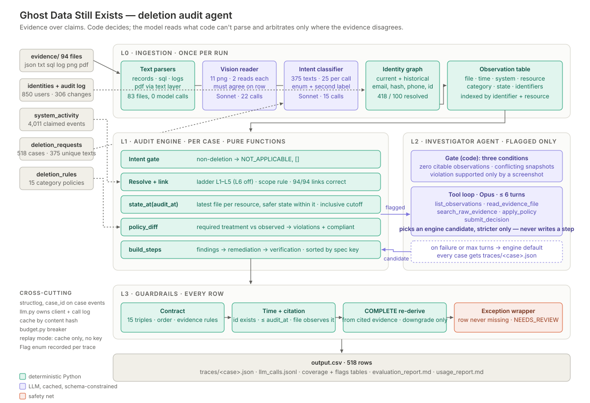
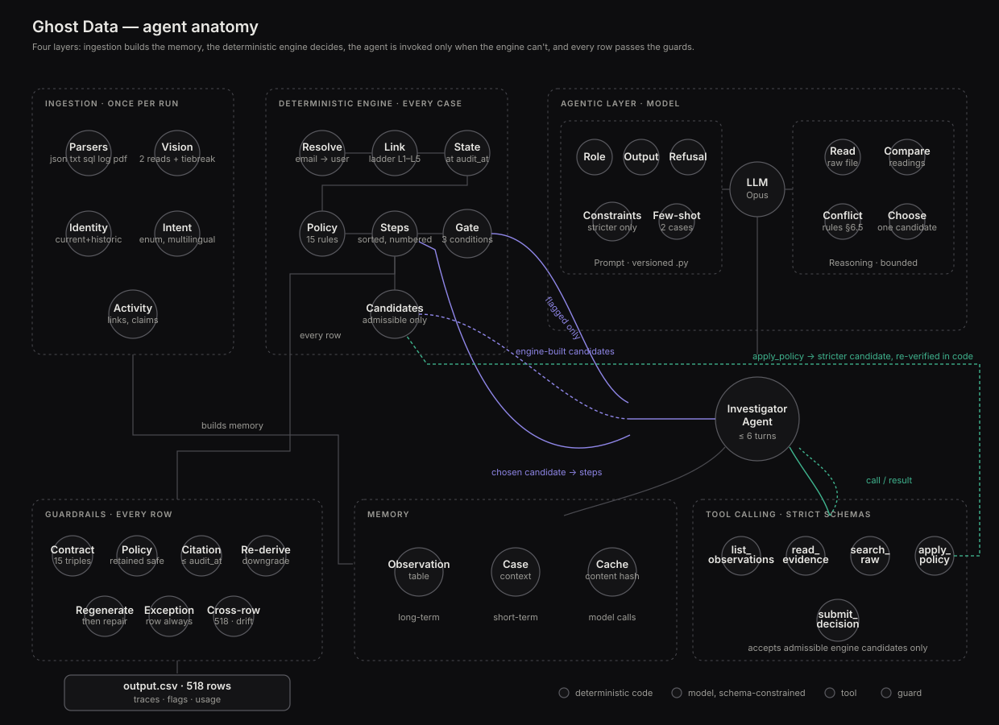

# Design brief — Ghost Data Still Exists

Text version of the diagram. Inputs (`dataset/`: 94 evidence files, identities
and audit log, `system_activity.csv`, `deletion_requests.csv`,
`deletion_rules.csv`) → **L0 ingestion**: text parsers
(`ingest/parse_records.py`, `parse_sql.py`, `parse_logs.py`, PDFs by text
layer; 83 files, no model), vision reader (`ingest/parse_vision.py`: two
Sonnet readings per PNG, an Opus tiebreak on disagreement), intent classifier
(`intent.py`), identity graph (`identity.py`); all feed the observation table
(`ingest/observations.py`) → **L1 engine**, per case (`engine/decide.py`:
intent gate → `linking.py` → `engine/state.py` `state_at` →
`engine/policy.py` `policy_diff` → `engine/steps.py` `build_steps`) → **L2
agent** on flagged cases only (`agent/candidates.py` gate, `agent/loop.py`
≤ 6 turns, `agent/tools.py`; picks an engine candidate, stricter only) → **L3
guards** on every row (`guards.py`, applied in `main.py`: contract, policy
contract, time + citation, COMPLETE re-derivation, regenerate then repair,
cross-row check, exception wrapper) → `output.csv`, one trace per case under
`runs/<mode>/<id>/traces/`, `llm_calls.jsonl`, run manifest. Cross-cutting:
`obs.py` (structlog), `llm.py` (model client, content-keyed cache, call log,
replay mode), `budget.py` (breaker), the `Flag` enum in `schemas.py`.

## 1. The problem

A deletion audit asks whether a person's deletion request was actually carried
out at a point in time (`audit_at`): every copy of their data — profiles,
replicas, search entries, exports, analytics, support records, backups, data
flows — must be in the state the policy requires, and nothing still running may
bring the data back. The workflow's own status and the activity stream's
results are claims; only evidence that shows a record counts. The expected
answers are generated by rules: a fixed table of allowed (phase, operation,
state) triples, one required action per data category, steps ordered by the
specification's operation table, citations to the evidence file that shows the
state. An answer key built that way is reproduced by code that applies the same
rules to the same facts, not by a model estimating them. So models supply
facts — a screenshot's fields, a request's label, the agent's reading of a
record — and code turns facts into steps, statuses and citations.

## 2. Principle: extract, then reason in code

Code extracts facts into one table and code decides. A model acts in exactly
three places, each where code cannot:

| Where | What the model does | What bounds it |
|---|---|---|
| Screenshots (`ingest/parse_vision.py`) | transcribes the facts printed for each record on a PNG, including whether it is shown not found, enabled, or restorable | two independent readings; a row is admitted when two agree on (resource, state, identifiers), with one tiebreak reading on any disagreement; for an id other evidence already knows, no agreement keeps the reading worse for the subject (`VISION_DISAGREED`); an unknown id needs agreement and is held (`VISION_ONLY_PENDING`); the id must match the resource pattern; state is derived in code (`observe_record`) from the transcribed fields |
| Request intent (`intent.py`) | labels each request text with one of six enum values, a confidence, a second label and an injection flag | these decide only whether the case is audited and which flags it carries; the text never reaches the engine; a non-deletion label on an injection-flagged request is audited as a deletion; a hand-labelled gold set checks it |
| Gated cases (`agent/`) | chooses between decisions the engine generated | three gate conditions, six turns, five tools, monotone admissibility (section 6) |

The rule: a model never writes a step, a status or a count. The only ids a
model ever passes are re-verified by code before use: a screenshot row's
resource id (pattern, agreement, and whether text evidence or
`system_activity` knows it), and the resource and file ids the agent gives
`apply_policy` (the file must be eligible at `audit_at`, must not be one the
parsers already extracted the resource from, and must show one of the
subject's identifiers within 15 lines of the resource id). The state of such a
record is the model's reading — the screenshot flags, or the agent's
`observed_state` — and is bounded by agreement for screenshots and by the
monotone rule for the agent (it can only make a decision stricter).

## 3. One schema for five formats

Every parser emits the same record, `Observation` in `schemas.py`:

| Field | Meaning |
|---|---|
| `file_id`, `captured_at` | the evidence file and when it was captured; decides whether it may be used or cited at a given `audit_at` |
| `observed_at` | when the fact holds (a log line's time, a snapshot's inner time) |
| `system_id`, `resource_id` | the logical system (replica tables keep the logical system; the table name goes in `source_detail`) |
| `data_category`, `state` | category from `deletion_rules.csv`; state in PRESENT, ABSENT, REDACTED, ANONYMIZED, IDENTIFIABLE, ACTIVE, DISABLED, BLOCKED |
| `identifiers` | every identifier on the record, raw |
| `source_detail`, `vision`, `retain_until` | provenance, whether it came from a PDF or screenshot, a stated retention date |

Complete snapshots also emit `Coverage` records, so a resource missing from a
full table can be read as absent. Because JSON exports, SQL snapshots, seven
log syntaxes, PDFs and screenshots all reduce to this one table
(`ingest/observations.py`: `observe_record`, `observe_ledger`, `build_table`),
linking, state, policy and the guards are written once and never know which
format a fact came from. Classification (system from the resource-id prefix,
category, state from the record's fields, identifiers) also lives in one place.

## 4. Layers

| Layer | Modules | Owns |
|---|---|---|
| L0 Ingestion, once per run | `ingest/manifest.py`, `parse_records.py`, `parse_sql.py`, `parse_logs.py`, `parse_vision.py`, `vision_prompts.py`, `observations.py`, `activity.py`; `identity.py`; `intent.py`, `intent_prompts.py` | the observation table, coverage records, the identity index (current and historical identifiers, reverse map), `system_activity` link facts and deletion-worker events, one intent per unique request text |
| L1 Engine, per case, pure functions | `engine/decide.py`, `linking.py`, `engine/state.py`, `engine/policy.py`, `engine/steps.py` | the decision: status and ordered, numbered steps |
| L2 Investigator agent, flagged cases only | `agent/candidates.py`, `agent/loop.py`, `agent/tools.py`, `agent/prompts.py` | the choice between engine candidates on the cases the engine cannot settle |
| L3 Guardrails, every row | `guards.py`, applied by `main.py` `decide_all` | whether a row may be written as decided, downgraded, regenerated or repaired |
| L4 Observability | `obs.py`, `llm.py`, `budget.py`, `main.py` | structlog warnings at every fallback, a trace per case, a run manifest per run, the model call log, the spend breaker |

## 5. Engine

Per case (`engine/decide.py` `decide_case`):

1. **Intent gate.** A non-deletion request is NOT_APPLICABLE with `[]`.
2. **Resolve.** The request email is matched exactly, after normalisation,
   against current and historical identifiers (`IdentityIndex.resolve_email`).
3. **Link** the subject's resources through the ladder below
   (`Linker.links`).
4. **Scope.** A resource whose last explicit observation before `requested_at`
   was ABSENT, or that was linked before `requested_at` with no evidence since,
   belongs to an earlier request and is left out (`state.out_of_scope`;
   found from samples where a user's March request leaked into an August case).
5. **`state_at(audit_at)`.** Facts come only from files captured at or before
   `audit_at` (inclusive). Files are ranked by the time of their latest fact
   about the resource and the latest wins; among that file's facts at that
   time the more exposed state wins, so a row surviving in a failover replica
   beats its absence from the primary. Absence by omission from a snapshot counts only
   for a resource never observed explicitly, or inside a file that observes it
   (a later bundle that simply does not list a retained record is not evidence
   it was deleted). A resource observed only in a file exported after
   `audit_at` has unknown state, not ABSENT.
6. **`policy_diff`.** Each resource's category and state against
   `deletion_rules.csv` gives a finding, remediation and verification, or a
   verification only when compliant. Backups are judged on restore access,
   data flows on enabled/disabled. RETAIN holds only while a stated retention
   date is not before `audit_at`. An attachment showing a second subject's
   identifiers gets no step and `SHARED_ATTACHMENT`.
7. **`build_steps`.** Any finding makes the case INCOMPLETE: findings cite
   evidence, remediation and verification are future work and cite nothing.
   Otherwise COMPLETE, with verifications citing the evidence that proves them.

### Linking ladder

Deleted and anonymized records carry no identifier, so a resource is tied to
the subject by the strongest of these, recorded per link with its layer and
confidence. Measured on the 32 samples (111 gold resources):

| Rung | Evidence | Links | Correct | Why it exists |
|---|---|---|---|---|
| L1 | an identifier (email, phone, hash, user id) in evidence captured ≤ `audit_at` | 76 | 75 | the direct case |
| L2 | `LINK_RESOURCE_IDENTITY` rows in `system_activity.csv` | 2 | 0 | explicit catalog links; both belong to an earlier request and the scope rule removes them |
| L3 | an identifier in a snapshot taken ≤ `audit_at` inside a file exported later — link only, never cited | 7 | 7 | the fact existed at audit time; only the export is late |
| L4 | PDF text and screenshots | 1 | 1 | records that exist only in a document or a screen |
| L5 | the only free primary-profile delete within 90 min of `reported_at` whose worker result matches `reported_status` | 11 | 11 | accounts that are deleted carry no identifier; reported_status tells us which worker run belonged to this request, and the evidence tells us what state that run left behind |
| L6 | the only free analytics anonymization in the same worker run | 3 | 1 | off by default (`Linker(enable_sibling=False)`) |

After the scope rule, 94 of 94 linked resources are in the answer key; 17 gold
resources stay unlinked. L5 and L6 are solved jointly across every
participant request (`Linker.prepare`): an account inferred for one case, or
tied to another user by L1–L4, is eliminated from every other case's
candidates, repeated until nothing changes — a batch of deletes shared by
several cases often resolves only by elimination.

### Ordering decisions

- **Step order.** Within each phase, steps are sorted by the operation's row
  in the spec table (`ALLOWED_TRIPLES` in `schemas.py`), then `system_id`, then
  `resource_id`. This sort is authoritative. The spec's "downstream before
  source" rule is satisfied by it because `DISABLE_DATA_FLOW` and
  `BLOCK_RESTORE` are the first two remediation rows, so flows and restores are
  always stopped before records are changed. None of the 32 samples
  contradicts this order.
- **Case order.** Rows in `output.csv` use natural numeric order on the
  `case_id` suffix (`case_99` before `case_100`), which matches
  `deletion_requests.csv`. Lexicographic order would be an equally valid
  presentation choice; the grader keys on `case_id`, not on row position.
- **Determinism.** Every set of identifiers, links or candidates that feeds
  output or a tie-break is sorted on content first; JSON is serialised with
  sorted keys and compact separators.

### Identity

- Matching is exact on normalised identifiers (emails lowercased, phones
  digits-only, hashes lowercased). Names never link records.
- An identifier shared by several users links to none of them and logs a
  warning (`AMBIGUOUS_IDENTIFIER` if it is the request email). Intended policy
  if one appears: the owner at the observation's `captured_at`, decided by
  `user_audit_log.event_time` (a TODO in `identity.py`).

## 6. Investigator agent

Text version: ingestion (parsers, vision with two readings and a tiebreak,
identity, intent, activity) builds the memory: the observation table
(long-term), the case session (short-term) and the content-hash cache (model
calls). The deterministic engine (resolve → link → state → policy → steps)
decides every case; its gate (`agent/candidates.py` `needs_agent`, three
conditions) sends flagged cases to the agent with admissible engine-built
candidates. The agent (`agent/loop.py` `run_agent`, `MODEL_AGENT`, ≤ 6
turns) runs on a versioned prompt (`agent/prompts.py`: role, output, refusal,
constraints — stricter only — and two few-shot cases), reasons by reading raw
files, comparing readings, applying the §6.5 conflict rule and choosing one
candidate, and acts only through five strict tools (`agent/tools.py`);
`submit_decision` accepts admissible engine candidates only, and
`apply_policy` can add a stricter candidate that code re-verifies. The chosen
candidate's steps return to the engine; every row then passes the guards
(contract, policy, citation, re-derivation, regenerate then repair, exception
wrapper, cross-row) into `output.csv`.

**Gate** (`needs_agent`), exactly three conditions:

1. a resolved subject with zero citable observations;
2. one in-scope resource with conflicting states in evidence of the same
   `captured_at`;
3. a violation whose only support is a held screenshot-only row
   (`VISION_ONLY_PENDING`).

An unflagged case, and every NOT_APPLICABLE case, never reaches the agent.

**Loop** (`run_agent`): the Messages API on `claude-opus-5-5` by default,
`tool_choice` auto, strict tool schemas, at most six turns. An unknown tool
gets a rejection and uses a turn; a tool that raises returns an error result;
a failed model call, refusal or budget breach ends in the engine decision with
`AGENT_UNAVAILABLE`; a rejected submission gets one repair message, a second
gives `AGENT_REJECTED_SUBMISSION`; six turns without a submission gives
`AGENT_MAX_TURNS`. Every case records `trace["agent"]`: gated or not, reasons,
turns, each tool call with arguments and a result summary, the candidates
offered and dropped, the choice.

**Tools** (strict Pydantic inputs, validated as the JSON the model sent):

| Tool | Does | May not |
|---|---|---|
| `list_observations` | the case's links, observations, treatments, held rows, flags and candidates | — (read only) |
| `read_evidence_file` | text of one eligible file, at most 20,000 characters (PDF text included); a PNG is attached as an image | open a file captured after `audit_at` |
| `search_raw_evidence` | exact match of one normalised identifier across eligible text, log, SQL and JSON files and activity rows (not PDFs or PNGs), at most 50 hits | fuzzy or partial matching |
| `apply_policy` | the rule for a resource in a state; inside a case, builds a stricter candidate from a record the parsers did not extract from that file | use an id absent from the file, a file the parsers already read that record from, a file without the subject's identifier within 15 lines of the id, a screenshot, or loosen the decision |
| `submit_decision` | ends the case with one candidate id | submit an id or step list the engine did not generate, or an inadmissible candidate |

**Monotone constraint.** As first merged, the agent could choose any engine
candidate. On the 9 gated cases it chose a less safe reading on 4: on samples
01 and 02 a candidate that dropped the L5 link (measured at 1.000), on 135 and
383 the ABSENT side of a same-file conflict. The guards reverted all 4. The
action space was then narrowed: a candidate is admissible only if it keeps
every finding and every resource of the engine default and never turns
INCOMPLETE into COMPLETE (`candidates.inadmissible`); candidates that switch a
measured rule off or a rejected rule on are not generated; a conflict offers
only its safer side. Re-run on the same 9 cases: 0 less-safe choices, 0
reverts, output unchanged. The agent can make an audit stricter, never looser;
today it changes no row.

## 7. Guards

Applied to every row by `main.py` `decide_all` through `guards.guard_decision`:

| Guard | Catches |
|---|---|
| Contract (`check_row`) | malformed JSON, wrong fields, a disallowed (phase, operation, state) triple, bad numbering or order, wrong evidence rules for the status, a finding without remediation and verification |
| Citation (`citation_issues`) | an evidence id that is unknown, captured after `audit_at`, or does not observe the resource it is cited for |
| COMPLETE re-derivation (`complete_check`) | a COMPLETE row whose cited files, read alone through the engine's state and policy code, show a violation or do not give the claimed state |
| Policy contract (`policy_issues`) | DELETE on audit, legal-hold, backup, tombstone, support-message or analytics records (unless a retention date passed); any `cache_*` or `email_delivery_*` resource |
| Regenerate, then repair | a row failing any check is regenerated by the engine without the agent; if that fails too, it is rebuilt from its own cited evidence (`CONTRACT_REPAIRED`) |
| Exception wrapper (`main.decide_all`, `main.engine_default`) | a case that raises still gets a row: COMPLETE `[]`, `ENGINE_ERROR`, `NEEDS_REVIEW` (that row is not re-guarded); an intent-stage failure audits every request as a deletion; a world that fails to load gives every case that row and exit 1 |
| Cross-row (`cross_row_check`, before writing) | a row count other than one per request (the file is not written, exit 1); a status mix far from the samples' (warning) |

**Asymmetry.** The COMPLETE re-derivation only ever downgrades: a refuted
COMPLETE becomes INCOMPLETE with findings that cite the file showing the
violation (`COMPLETE_DOWNGRADED`); an INCOMPLETE row is never promoted by it.
The last-resort repair can end on COMPLETE when nothing citable is left, and
then always adds `NEEDS_REVIEW`; it has never fired on the data. The agreed
fallback — a resolved subject with no evidence-backed step written as COMPLETE
`[]` with `NEEDS_REVIEW` — is kept as is, because no valid row exists without
an invented finding.

## 8. Failure handling

| Failure | What happens | Flag |
|---|---|---|
| No API key | with a model-answer cache: replay mode, cached answers only; without one: PDFs and text parsed, screenshots deferred, every request audited as a deletion, gated cases keep the engine decision | `VISION_UNAVAILABLE`, `INTENT_UNAVAILABLE`, `AGENT_UNAVAILABLE` |
| API down | the SDK retries 4 times with backoff (`llm.SDK_RETRIES`), then `LLMExtractionFailed`: an intent batch is audited as deletions; a screenshot file is recorded as failed; the agent falls back to the engine decision | `INTENT_UNAVAILABLE`, `PARSE_FAILED`, `AGENT_UNAVAILABLE` |
| Malformed model JSON | one fresh retry (`llm.JSON_ATTEMPTS`), then as above | as above |
| Unparseable file | the file is isolated as failed; every other file and case continues | `PARSE_FAILED` on cases audited after its capture |
| Budget breach | `budget.Budget` (200 calls / $10 by default, `GHOSTAUDIT_MAX_CALLS`, `GHOSTAUDIT_MAX_USD`) stops further calls; extractions fail as above | `BUDGET_BREACHED` |
| Cache miss in replay mode | never called; the stage degrades | `VISION_UNAVAILABLE`, `INTENT_UNAVAILABLE`, `AGENT_UNAVAILABLE` |
| A case raises | engine default row | `ENGINE_ERROR`, `NEEDS_REVIEW` |
| Intent stage raises | every request audited as a deletion | `INTENT_UNAVAILABLE` |
| World fails to load (evidence unreadable) | every case gets the engine default row; exit 1 | `ENGINE_ERROR`, `NEEDS_REVIEW` |
| Damaged cache entry | treated as a cache miss | — |

## 9. Evaluation design

- **Six suites** (`evaluation/main.py`): contract, samples (status, step
  precision/recall, field accuracy on aligned steps, exact sequence, per-case
  dump; `--observations-only` reports the ladder, `--enable-sibling` measures
  L6), coverage (per format, per case, single-file cases), custom (20-row
  intent gold set, injection identity, privacy-intake cross-check),
  metamorphic (engine only: rerun, shuffled manifest, uppercased emails, decoy
  user, late file), complete-check.
- **Mutation-tested scorer.** The answer key scored against itself gives 1.000
  on every metric; `tests/test_harness.py` perturbs a status, a citation and a
  case and checks the scores drop.
- **Adoption gate.** A change is kept only if no sample metric regresses and
  every contract check still passes; each kept change is in the change log of
  `evaluation/evaluation_report.md` with before and after.
- **Tune versus measure.** `--mode tune` writes under `runs/tune/` and is for
  iteration; `--mode measure` writes `output.csv` at the repository root,
  refuses live model calls unless `--allow-live` is passed (`LLM.allow_live`),
  and records the commit hash, dirty flag, whether live calls were allowed and
  the effective model-access mode in the run manifest. The reported run was
  made at a clean commit with models pinned; `usage_report.md` is generated
  from it.

## 10. Decisions

| Option | Decision | Reason or measurement |
|---|---|---|
| Embeddings / RAG over evidence | rejected | the joins are exact identifiers; similarity search would merge near-identical decoys (`jonas.berg` / `jonas.berglund`); the agent's only retriever is exact lexical `search_raw_evidence` |
| An agent framework | not used | the loop is a short manual tool-use loop over the Messages API (`agent/loop.py`), so the turn bound, allowlist, repair message and candidate-only submission are explicit code |
| A model call per case | rejected | the key is rule-generated and ordering is mechanical; the agent runs on 6 of 518 cases |
| L5 narrow ±10-minute pass before the 90-minute window | removed | it made 13 links with 2 wrong (cases 18 and 20 took other cases' deletes); the 90-minute window with the result filter alone made 11 of 11 |
| Blanket DELETION fallback on any low-confidence intent | narrowed to hesitation involving DELETION | intent gold 18/20 → 20/20; privacy-intake cross-check 8/10 → 10/10 |
| L6 sibling-by-burst for anonymized analytics | off by default | 1 of 3 correct on the samples |
| Server-side `fallbacks="default"` on model calls | removed | a refusal must be logged with the model that refused, so usage stays attributable per model |
| Trusting `reported_result` / `reported_status` as state | rejected | sample 05 reports success while a failover replica still holds the account; status is used only to pick the worker run in L5 |

## 11. Known limitations

- 17 of 111 gold resources in the samples cannot be linked from the public
  data: accounts in delete batches shared by several cases, analytics records
  anonymized with no identifier, and records in no participant file.
- needs_review rows: `case_61` (evaluation) and `case_04` (samples) are
  COMPLETE `[]`; the contract suite reports them as `complete_empty`.
- 12 screenshot rows whose ids no other source knows are held
  (`VISION_ONLY_PENDING`); 5 belong to `case_45`.
- `case_527`: ticket attachment `support_3896` is treated as a support message
  (REDACT) because a later file classifies it so; which classification should
  win is ambiguous and no sample covers it.
- 504 of 518 evaluation subjects are observed in exactly one eligible evidence
  file, so a single misread file decides a case.
- The agent changes no row today.
- The 32 labelled samples were used both to tune and to report: the sample
  scores are training-set scores. NOT_APPLICABLE has no labelled sample; it is
  checked by the 20-row intent gold set and the privacy-intake cross-check.
